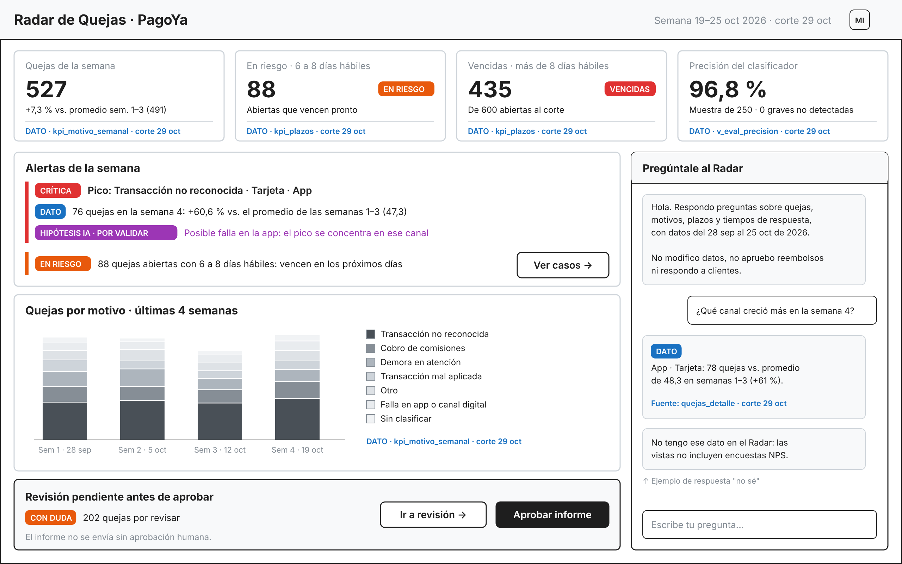

# Radar de Quejas – PagoYa

Agente de IA que clasifica las quejas de una fintech, detecta qué motivo está
creciendo y prioriza las que tienen riesgo de fraude o de vencer el plazo, con
revisión humana antes de enviar el informe semanal.

> Estado: en construcción (semana 4 de 8). PagoYa es una empresa ficticia.

## El problema
En 2025 la Superintendencia Financiera recibió 2,76 millones de quejas, un
récord; cerca del 39 % fueron por transacciones no reconocidas.
[Ver fuentes y canvas completo](docs/canvas_radar_quejas.md)

## Cómo funciona (diseño)

1. SQL limpia los datos y enmascara información sensible.
2. Un modelo de IA pequeño clasifica cada queja con una taxonomía definida.
3. SQL calcula los KPI: quejas por motivo, en riesgo y vencidas.
4. La IA redacta los hallazgos a partir de esas cifras.
5. Una analista revisa las quejas de prioridad alta antes de enviar el informe.

## Datos
Todos los datos son **sintéticos**: 2.000 quejas en 4 semanas, generadas con
IA y calibradas con proporciones de la SFC. Incluyen errores de ortografía,
ironía, comentarios vacíos y un patrón sembrado para probar la detección.
El motivo real está en un archivo separado para evaluar el clasificador sin
que lo vea. [Diccionario de datos](data/diccionario_datos.md)

| Validación | Resultado |
|---|---|
| Filas únicas | 2.000 |
| Periodo | 28 sep – 25 oct 2026 (4 semanas completas; fecha de corte 29 oct) |
| Transacción no reconocida | 39 % (780 quejas) |
| Comentarios vacíos | 5 % (100 quejas) |
| Pico sembrado en semana 4 | Sí: +60,6 % en no reconocidas con tarjeta por app frente al promedio de las semanas 1 a 3 |

## Avance
- [x] Semana 1: canvas, base de conocimiento y dataset sintético validado
- [x] Semana 2: flujos en n8n (semáforo, clasificador, RAG y aprobación humana)
- [x] Semana 3: base de datos y agente
  - Esquema en Supabase con taxonomía como tabla y restricciones de calidad
  - Vistas SQL de KPI: plazos, tiempo de respuesta, motivos por semana
  - Clasificador idempotente que lee y escribe en la base (96,8 % en 250 quejas)
  - Agente text-to-SQL de solo lectura, con seguridad probada en dos capas
  - Principios de UX para IA y auditoría del Radar ([ver](docs/principios_ux.md))
- [ ] Semana 4: interfaz, dashboard y video demo
  - Wireframes del panel y de la bandeja de revisión ([ver](docs/wireframes/sistema_diseno.md))
  - 

## Seguridad del agente
| Prueba | Resultado |
|---|---|
| El agente intenta leer una tabla protegida | Se niega (prompt) |
| La credencial del agente consulta una tabla protegida | permission denied (base de datos) |
| La credencial del agente consulta las vistas autorizadas | 2.000 filas |

## Limitaciones conocidas
- Datos sintéticos: el KPI de quejas vencidas (~87 %) es un efecto de cómo se
  generó el dataset, no un comportamiento real.
- La conexión local de n8n a Supabase omite la verificación del certificado SSL.
- El enmascaramiento de datos sensibles antes de la IA aún no está construido.

## Flujos
| Archivo | Qué hace |
|---|---|
| `workflows/01_hola_mundo.json` |	Primer flujo: prueba de conexión con el modelo |
| `workflows/02_semaforo_plazos.json` | Calcula días hábiles y separa vencidas, en riesgo y en plazo |
| `workflows/03_clasificador.json` | Clasifica quejas en JSON; la prioridad sale de una regla |
| `workflows/04_rag_politica.json` | Responde sobre la política citando la fuente |
| `workflows/05_aprobacion_humana.json` | Detiene el flujo hasta que una analista aprueba o devuelve |
| `workflows/06_apis.json` |	Consume APIs (TRM de datos.gov.co) con HTTP Request |
| `workflows/07_clasificador_supabase.json` |	Clasifica leyendo y escribiendo en Supabase, sin duplicar |
| `workflows/08_agente_consulta.json` |	Agente que responde preguntas con SQL de solo lectura |

## Autora
Sandra Milena López · [LinkedIn](https://linkedin.com/in/smilenalopezpuentes)
